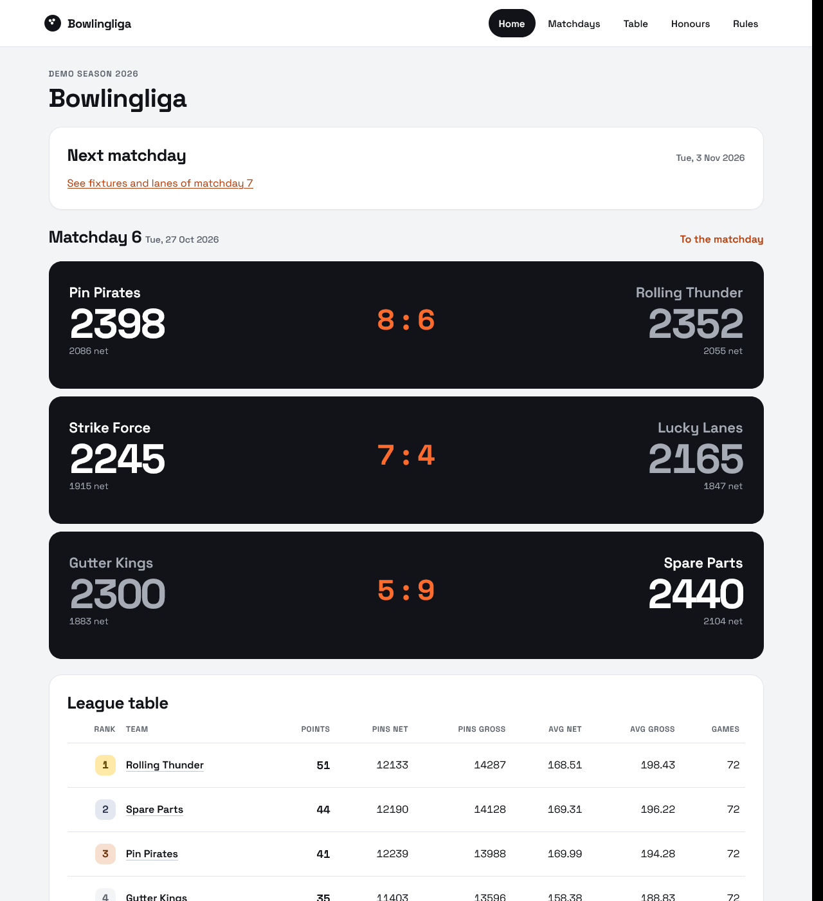
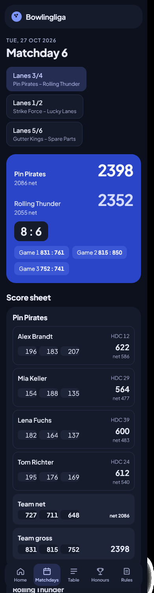
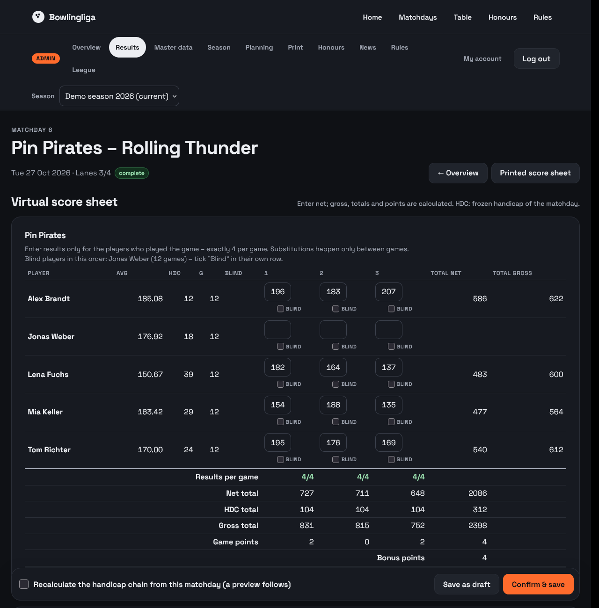
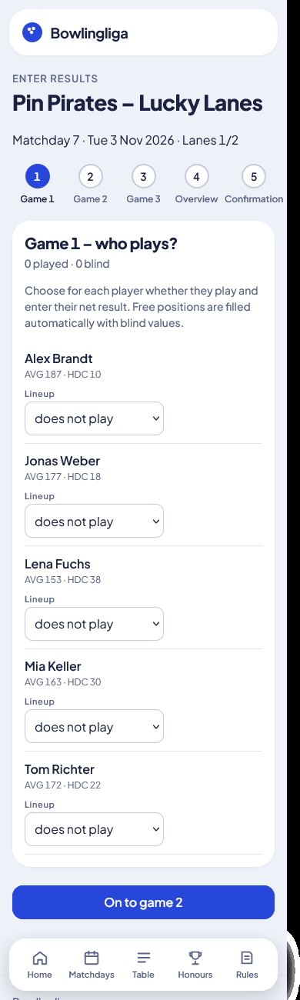
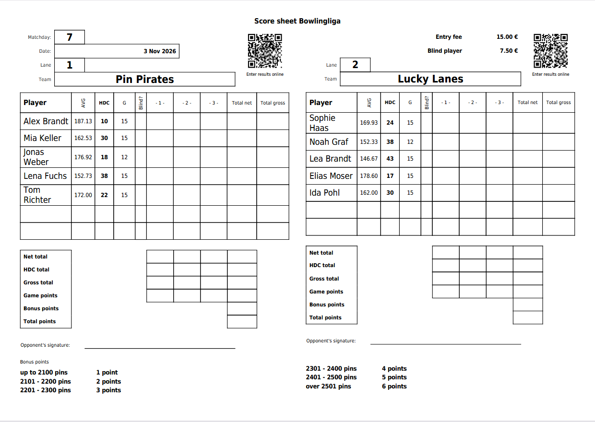

# Bowlingliga – website for a bowling league

[](https://github.com/KaiL3/bowlingliga/actions/workflows/tests.yml)

Bowlingliga runs the website of a handicap bowling league: the public pages
with standings, matchdays, average lists and honours, and an admin area for
everything behind them – seasons, schedule and lanes, results, printed score
sheets. Teams can enter their own results on their phones; the opponent
confirms them. Handicaps, points and tables are calculated automatically.

The league name, the season rules and the languages are configurable, so the
software is not tied to one league. It runs on a small server with PHP and
MariaDB, without a framework and without external services.

<p>
  
  
</p>

## Features

**Public pages**
- Home page with the last matchday, the next matchday with its lanes, the
  league table and news posts.
- Matchdays with fixtures, lanes, the score sheet of every fixture, the day
  table and the average lists of the teams.
- League table, honours (highest game and series, net and gross, for women
  and men) and a rules page with the handicap table of the season.
- German and English, chosen by each visitor; two styles (Lane, Bento) with
  light and dark mode; made for phones as much as for desktops.

**Result entry**
- Virtual score sheet for the league management: net results per game,
  gross, totals, game and bonus points are calculated as you type.
- **Teams enter their own results** via a QR code on the printed score sheet,
  game by game; the opponent confirms, and only then do the results count.
- Blind players and a ghost team for odd team counts are handled by the
  rules, including derived blind values.
- Photos or PDFs of the paper score sheets can be uploaded as evidence.

**Season management**
- Seasons with their own rule settings: handicap formula, target score,
  maximum handicap, entry and blind fees, how long the previous season counts
  in the average.
- Schedule generation with even lane assignment, positiondays (fixtures from
  the standings) and lot draws.
- Printed score sheets as PDF for a fixture or a whole matchday.
- Handicaps are frozen per matchday; corrections recalculate the handicap
  chain only after a preview and confirmation.

**Operation**
- Admin accounts with two-factor login (TOTP).
- Install and update scripts for Debian with nginx, MariaDB and HTTPS.
- Data transfer between installations (export/import) and a backup guide
  (database plus score sheet directory).

<p>
  
  
</p>
<p>
  
</p>

The screenshots show the fictional league of `bin/seed-demo.php`.

## Quick start

Requirements: PHP ≥ 8.4 with `pdo_mysql`, `sodium`, `gd`, `mbstring`, `zip`,
Composer and a local MariaDB 10.11 or newer (MySQL is not supported: the
migrations use MariaDB syntax).

```bash
git clone https://github.com/KaiL3/bowlingliga.git && cd bowlingliga
composer install
# an empty database and a user for it, e.g. as MariaDB root:
#   CREATE DATABASE bowlingliga CHARACTER SET utf8mb4 COLLATE utf8mb4_unicode_ci;
#   CREATE USER 'bowlingliga'@'localhost' IDENTIFIED BY '…';
#   GRANT ALL ON bowlingliga.* TO 'bowlingliga'@'localhost';
cp config/database.php.example config/database.php   # fill in the database and a totp_key
php bin/migrate.php                                   # creates the schema
php bin/seed-demo.php                                 # optional: a fictional league to try things out
php bin/create-admin.php admin                        # first admin account
php -S 127.0.0.1:8000 -t public
```

Then open <http://127.0.0.1:8000>; the admin area is at `/admin`. The comments
in `config/database.php.example` explain every setting, including how to
generate the `totp_key`.

## Installation on a server

`deploy/install.sh` sets up a complete instance on Debian 13, or Debian 12 with a newer PHP (nginx,
PHP-FPM, MariaDB, Let's Encrypt), `deploy/update.sh` updates it. Several
leagues can run on one server. See [docs/operations.md](docs/operations.md).

## Documentation

The documentation lives in [docs/](docs/README.md):

- [domain-logic.md](docs/domain-logic.md) – the league rules R1–R38, the
  authoritative description of what the software does,
- [architecture.md](docs/architecture.md) – layers, ports and adapters,
  security, transactions,
- [data-model.md](docs/data-model.md), [routes.md](docs/routes.md),
  [testing.md](docs/testing.md), [development.md](docs/development.md),
- [glossary.md](docs/glossary.md) – the German domain terms and their English
  names.

## Development and tests

```bash
php vendor/bin/phpunit                   # all suites, needs a MariaDB for the integration tests
php vendor/bin/phpunit --testsuite Unit  # fast, no database needed
```

Unit, property-based (eris) and integration tests cover the domain rules;
GitHub Actions runs the complete suite with PHP 8.4 and 8.5 against MariaDB
10.11 and 12.3 for every pull request. Details in [docs/development.md](docs/development.md).

## Contributing

Contributions are welcome – from bug reports to new languages. Start with
[docs/contribute.md](docs/contribute.md); [AGENTS.md](AGENTS.md) has the rules
in short form, also for AI coding agents.

## Security

Please report vulnerabilities privately, not as a public issue – see
[SECURITY.md](SECURITY.md).

## License

Copyright (C) 2026 KaiL3 and the Bowlingliga contributors

This program is free software: you can redistribute it and/or modify it under
the terms of the GNU General Public License as published by the Free Software
Foundation, either version 2 of the License, or (at your option) any later
version. See [LICENSE](LICENSE) for the full text of version 2.

This program is distributed in the hope that it will be useful, but WITHOUT
ANY WARRANTY; without even the implied warranty of MERCHANTABILITY or FITNESS
FOR A PARTICULAR PURPOSE.

The dependency mPDF is licensed under GPL-2.0-only, so a distribution that
includes it is covered by version 2. The other dependencies are under MIT,
"MIT OR Apache-2.0" (php-qrcode) and LGPL-2.1-or-later (HTML Purifier).
